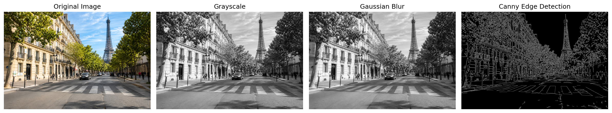

# Image Processing with OpenCV

A beginner-friendly Computer Vision project
developed using Python and OpenCV.

## Project Overview

This project demonstrates fundamental image
processing techniques used in Computer Vision.

## Technologies

- Python
- OpenCV
- NumPy
- Matplotlib (visualization)

## Implemented Techniques

1. Grayscale conversion
2. Gaussian blur
3. Canny edge detection

## Results

The following image shows the original input
and the results of the processing pipeline.



## How to Run

Install OpenCV:

```bash
pip install opencv-python
```

Place an image named `input.jpg` in the
project folder and run:

```bash
python image_processing.py
```

The processed images will be saved in
the `results` folder.

## Future Improvements

- Image thresholding
- Image segmentation
- Object detection

## Author

Lina Hadil Makhlouf

MSc Machine Vision & Artificial Intelligence
Université d'Évry Paris-Saclay
